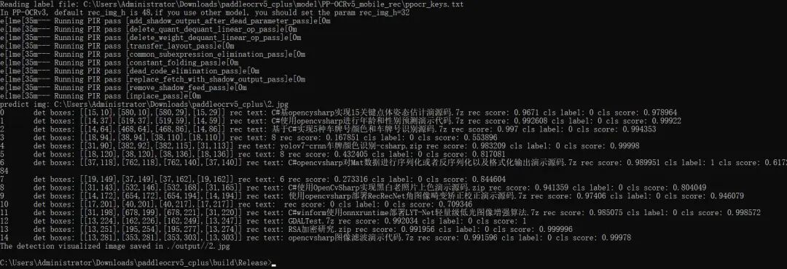
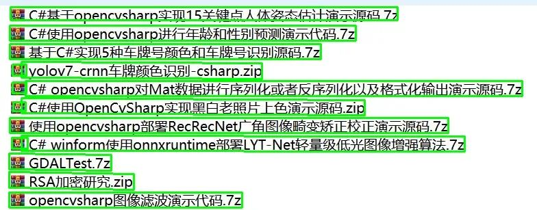

# [cmake project] deploying the PP-OCRv5 model on Windows using C++ programming

# PaddleOCRv5 C++ Inference Project Tutorial

## 1. Project Overview

This project is based on PaddleOCR v5, using Paddle Inference and OpenCV to implement Chinese and English text detection and recognition, supporting direction classification. It is suitable for secondary development and deployment under the Windows platform.

## 2. Environmental Preparation

- Operating System: Windows 10/11

- Compiler: Visual Studio 2019 or 2022

- CMake: Suggests version 3.14 or above (e.g., 3.30.1)

- OpenCV: Suggested version 4.9.0 (other versions available)

- Paddle Inference: 3.0.0 CPU version (included in the directory paddle_inference-3.0.0-cpu of this project)

## 3. Dependency Installation

1. Install Visual Studio 2019/2022 (including C++ development components).

2. Install CMake (https://cmake.org/download/).

3. Download the precompiled OpenCV package and unzip it (e.g., https://github.com/opencv/opencv/releases/download/4.9.0/opencv-4.9.0-windows.exe).

4. Confirm that the `paddle_inference-3.0.0-cpu` directory exists.

## 4. Model Preparation

Place the following model folders into the `model/` directory:

- `PP-OCRv5_mobile_det`: Text detection model

- `PP-OCRv5_mobile_rec`: Text recognition model

- `ch_ppocr_mobile_v2.0_cls_infer`: Direction Classification Model

- `ppocr_keys.txt`: Dictionary file

## 5. Compilation Method

1. Modify the following path in `CMakeLists.txt` to your local actual path (note that there should be no Chinese or spaces):

   ```cmake

   SET(PADDLE_LIB "C:\\Your path\\paddle_inference-3.0.0-cpu")

   SET(OpenCV_DIR "D:\\Your path\\opencv\\build\\x64\\vc16\\lib")

   ```

2. Generate VS project using CMake or directly compile:

   ```shell

   mkdir build

   cd build

   cmake ..

   cmake --build . --config Release

   ```

3. After compilation, the directory `build/Release/` will generate `ppocr.exe` and the required DLLs.

## 6. Running Method

1. Switch to the `build/Release/` directory.

2. Execute the following command (replace the path with your actual model and image paths):

   ```shell

   ppocr.exe \

     --det_model_dir=C:\Path\model\PP-OCRv5_mobile_det \

     --rec_model_dir=C:\Path\model\PP-OCRv5_mobile_rec \

     --cls_model_dir=C:\Path\model\ch_ppocr_mobile_v2.0_cls_infer \

     --image_dir=C:\Path\2.jpg \

     --use_angle_cls=true --det=true --rec=true --cls=true \

     --rec_char_dict_path=C:\Path\model\ppocr_keys.txt

   ```

3. The results will be output in the command line. If `--visualize=true` is enabled, the detection result images will be saved in the specified directory `--output`.

## 7. Parameter Explanation

- `--det_model_dir`: Detection model directory

- `--rec_model_dir`: Recognition model directory

- `--cls_model_dir`: Directory for direction classification model

- `--image_dir`: Path or directory of the image to be recognized

- `--rec_char_dict_path`: Dictionary file path

- `--use_angle_cls`: Whether to use directional classification

- `--det`: Whether to enable text detection

- `--rec`: Whether to enable text recognition

- `--cls`: Whether to enable directional classification

- `--output`: Output directory of results (optional)

- Other parameters are detailed in `main.cpp` and source code comments

Original image:


Result of recognition:





## 8. Common Issues

- **Paths cannot contain Chinese or spaces**, otherwise it may cause the model to fail to load.

- If a DLL is missing, ensure that there are `paddle_inference.dll`, `common.dll`, `mkldnn.dll`, `libiomp5md.dll`, `mklml.dll` etc. under `build/Release/`.

- OpenCV needs to be the same version as during compilation.

## 9. Secondary Development Guide

- The main entry point is `src/main.cpp`, which can be modified according to actual needs by modifying parameters or calling flows.

- The core logic of OCR is found in `src/paddleocr.cpp`, supporting batch image recognition, detection, and direction classification among others.

- If integrated into other projects, refer to the interface of the `PPOCR` class.


## Payment

Here is a pay link on Stripe ( https://buy.stripe.com/3cs8yP7sY87d0vu9AB ). Please contact me lonlonago@foxmail.com after funding $89, and I will send you a complete data files , thank you!


